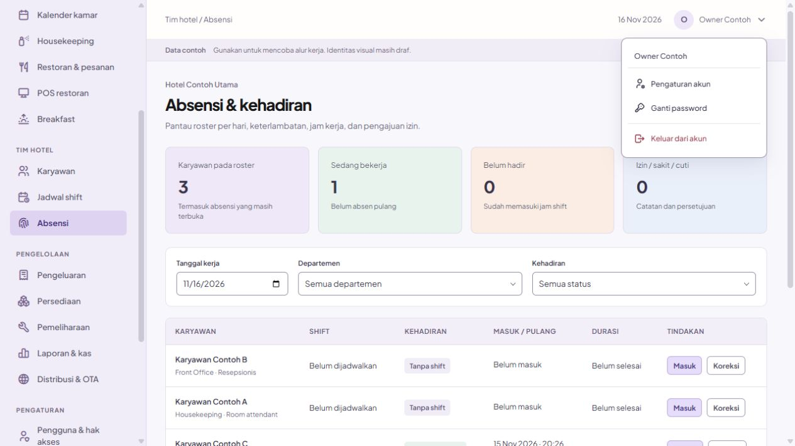

# Audit modul hotel, 16 November 2026

> Snapshot sebelum pembaruan absensi mandiri dan impor mesin. Implementasi terbaru serta hasil 55 pengujian tersedia di [EMPLOYEE-ATTENDANCE.md](EMPLOYEE-ATTENDANCE.md).

Audit dilakukan pada checkout lokal Laravel/PHP 8.2.29 dengan MariaDB 10.4.22. Pemeriksaan mencakup kode route/controller/service, otorisasi dan relasi hotel, perhitungan transaksi, pengujian integrasi, navigasi 20 halaman, dan reflow ponsel/tablet. Temuan yang jelas diperbaiki dalam checkout ini. Tidak ada konektor OTA atau pembayaran eksternal yang dijalankan.

## Temuan dan perbaikan

| Prioritas | Temuan sebelum perbaikan | Hasil dan bukti |
| --- | --- | --- |
| P1 | API menyembunyikan `total` tetapi masih mengirim `room_total` dan `nightly_rate` kepada pembaca reservasi tanpa izin nominal. | Ketiga nominal disembunyikan pada daftar, embedded reservation papan kamar, dan endpoint detail. Uji payload per peran lulus. |
| P1 | Pembayaran kamar sebagian dan mutasi stok dapat dicatat ulang ketika permintaan dengan nilai sama dikirim ulang. | UUID per formulir, indeks unik per hotel, dan pengembalian hasil transaksi sebelumnya. Uji pengulangan memastikan satu pembayaran/satu mutasi. Klien API lama tanpa UUID tetap diterima; klien baru wajib memakai `request_key` untuk jaminan retry. |
| P1 | Tab lama berpotensi membuat data pada hotel yang telah diganti melalui tab lain. | UI mengirim `X-Hotel-ID`; HotelContext menolak ketidakcocokan dengan 409 sebelum menulis. Perubahan hotel pada polling menyebabkan reload sehingga keranjang/cache lama tidak dipakai. Uji menolak pembuatan biaya pada hotel yang salah. Header ini adalah perlindungan konteks UI; otorisasi keanggotaan hotel tetap diperiksa terpisah oleh server. |
| P1 | Transisi/check-in identitas mengambil ID kamar sebelum memperoleh lock. Jika petugas lain memindahkan kamar di antaranya, operasi dapat memakai kamar lama. | Setelah lock reservasi, ID kamar dibandingkan kembali dan perubahan bersamaan ditolak. Ini hasil tinjauan kode dan pengujian alur pindah/check-in biasa; belum merupakan uji stres multi-proses. |
| P1 | Izin pengaturan identitas hotel juga mengizinkan penyesuaian jurnal. | Izin baru `finance.manage`, bergantung pada `finance.view`, mengontrol akun, penyesuaian dan sinkronisasi jurnal. Pengguna dengan `hotel.manage` saja ditolak oleh uji endpoint. |
| P2 | Record izin tanpa `clock_in` bisa dianggap absensi masuk terbuka. Absensi lama atau milik karyawan nonaktif juga sulit diselesaikan dari roster. | Record terbuka wajib memiliki waktu masuk. Roster menyertakan absensi lama yang belum ditutup serta karyawan terkait. Absen pulang tetap diizinkan setelah nonaktif; penjadwalan baru karyawan nonaktif ditolak. |
| P2 | Koreksi hadir dapat memasukkan waktu di masa depan. Pemilihan shift pertama dapat keliru pada hari dengan shift lintas malam. | Validasi terhadap waktu hotel; UI memilih shift terdekat dengan waktu masuk. Uji waktu masa depan ditolak dan shift malam tetap lulus. |
| P2 | Password baru belum memeriksa batas byte bcrypt dan karakter NUL. | Aturan bersama menolak password di atas 72 byte dan NUL pada ganti password, pengguna baru dan provisioning CLI. Uji ASCII panjang, UTF-8 multibyte dan NUL mengembalikan 422. |
| P2 | Input email berupa array pada perubahan profil menghasilkan error server. | Normalisasi hanya terhadap string, kemudian validasi. Uji mengembalikan 422. |
| P2 | Setelah pergantian password, token CSRF navbar logout dapat tertinggal; sesi lain juga memerlukan pemeriksaan hash password. | Pembaruan CSRF mencakup meta dan hidden form; middleware `auth.session` menolak hash sesi lama. Uji perubahan password, penghapusan sesi lain, dan hash lama lulus. Password akun demo yang digunakan browser tidak diubah. |
| P2 | Parameter tanggal publik tidak valid dapat kembali ke URL invalid. | Redirect pemulihan ke URL booking dasar dengan pesan validasi; uji GET invalid dan halaman pemulihan lulus. |
| P2 | Lantai terpilih kembali keluar dari area panel setelah render; pencarian lantai hilang pada ponsel. | Pencarian tersedia di ponsel, `aria-pressed` menandai pilihan, dan panel menggulir ke lantai terpilih. Lantai 20 menampilkan delapan kamar pada fixture 184 kamar. |
| P2 | Kapasitas kamar dapat diturunkan di bawah jumlah tamu reservasi aktif. | Pembaruan kapasitas ditolak jika tidak dapat menampung reservasi aktif. |
| P2 | Dialog dapat selesai ketika refresh lain belum selesai; nominal ringkasan lama belum mengurangi refund. | Refresh formulir menunggu pemuatan selesai; ringkasan bersih mengurangi refund. Laporan utama tetap memakai jurnal. |

Migrasi `2026_11_16_000005_transaction_retry_keys` telah diterapkan ke database lokal tanpa reset tabel. Data demo asli dipertahankan. Pembaruan sebelumnya menambahkan dua reservasi contoh pada **Hotel Contoh 20 Lantai** untuk alur check-in/deposit dan booking website; seluruh nama/kontak/dokumen pengujian bersifat fiktif.

## Cakupan per modul

Lulus berarti skenario yang disebut telah diperiksa. Itu tidak berarti seluruh kemungkinan alur, beban, atau integrasi produksi telah disertifikasi.

| Modul | Pemeriksaan | Hasil / batas |
| --- | --- | --- |
| Login & sesi | Login benar/salah, sesi baru, pembatasan route, password-bound session, CSRF, logout browser. | Lulus pada skenario yang diuji; MFA dan pemulihan password belum ada. |
| Papan kamar | Status, fasilitas, pencarian, lantai 20, maksimal 24 kartu/halaman. | Lulus UI; pagination kartu masih di browser dan API mengambil seluruh kamar. |
| Reservasi / PMS | Kapasitas, overlap/tanggal bersebelahan, harga server, check-in/out, pindah/perpanjang, pembatalan. | Lulus; belum grup booking/rate plan musiman. |
| Kalender kamar | Navigasi minggu, filter lantai, label terpisah, rentang booking dan header tetap. | Halaman desktop/mobile/tablet terbuka; belum uji puluhan ribu booking aktif. |
| Identitas check-in | Nomor/dokumen terenkripsi, payload tersamarkan, izin baca terpisah, rollback check-in kamar kotor. | Lulus; belum OCR, verifikasi Dukcapil, atau alur retensi/penghapusan dokumen. |
| Pembayaran/deposit/refund | Harga/saldo, batas refund, terima/pakai/kembali deposit, retry, checkout ditolak saat deposit tertahan. | Lulus; pencatatan lokal setelah petugas menerima/mengembalikan uang, tanpa gateway. |
| Invoice | Nominal snapshot, rincian POS, pembayaran bersih/refund dan isolasi hotel. | Lulus; bukan faktur pajak. |
| Housekeeping | Status, petugas, larangan mengubah kebersihan kamar yang masih ditempati. | Berjalan sesuai aturan saat ini; layanan kebersihan harian kamar terisi belum memiliki alur khusus. |
| Restoran & pesanan | Multi-menu, status berurutan, item tenant lain ditolak, pajak/service dan tagihan kamar sekali. | Lulus; pembatalan/refund POS dan split bill belum ada. |
| POS restoran/spa/fasilitas | Outlet dan menu harus sesuai, keranjang, harga server, bayar langsung/tagihan kamar, struk. | Lulus; spa adalah penjualan layanan, belum jadwal appointment. Pajak/service masih satu konfigurasi per hotel. |
| Breakfast | Kuota harian, batas porsi, retry, tanggal checkout, pengecualian jam dengan alasan. | Lulus; tidak mengaktifkan paket breakfast otomatis pada reservasi lama. |
| Karyawan | CRUD dasar/aktivasi, izin, karyawan nonaktif dengan absensi terbuka. | Lulus; akun login dan data karyawan masih entitas terpisah. |
| Shift | Bentrok, relasi tenant, lintas malam, larangan shift baru untuk karyawan nonaktif. | Lulus; belum pertukaran shift, payroll dan aturan lembur. |
| Absensi & izin | Roster tanggal, masuk/pulang, koreksi, izin/cuti dan persetujuan. | Lulus pada skenario teruji; masih dicatat petugas berizin, tanpa mesin absensi/biometrik. |
| Pengeluaran | Nominal, persetujuan/penolakan sekali, otorisasi dan jurnal saat disetujui. | Lulus; lampiran bukti, supplier/procurement dan reimbursement belum tersedia. |
| Persediaan | Stok tidak negatif, siklus linen, pemakaian per kamar, retry mutasi. | Lulus; pemakaian masih manual dan belum procurement. |
| Pemeliharaan | Pemblokiran kamar, penyelesaian semua tiket sebelum dibuka, kebersihan menjadi kotor. | Lulus; belum preventive maintenance berulang/SLA. |
| Laporan & kas | Jurnal seimbang, sinkronisasi historis tanpa duplikasi, kas harian, akun/neraca saldo dan izin penyesuaian. | Lulus; basis kas, belum akrual/piutang, rekonsiliasi bank/OTA, tutup kas per shift, penguncian periode dan laporan pajak. |
| Distribusi & OTA | Konfigurasi tenant dan kredensial terenkripsi, status jujur belum aktif. | **Belum terhubung**. Pemilik belum mempunyai akses mitra/API; tidak ada uji penyedia produksi. |
| Booking langsung | Halaman publik, harga/ketersediaan, retry, konflik, konfirmasi dan pemulihan tanggal invalid. | Lulus alur contoh hingga masuk PMS; pembayaran online belum ada. |
| Pengguna, peran & akun | Isolasi relasi, Owner dilindungi, izin endpoint, profil, form password dan logout navbar. | Lulus pada matriks teruji; lifecycle penonaktifan akun pengguna/MFA/reset belum lengkap. |
| Pengaturan, audit & panduan | Seluruh halaman terbuka, konfigurasi per hotel, jejak perubahan dan instruksi terbaru. | Berjalan; audit masih database aplikasi, belum log eksternal yang immutable atau retensi otomatis. |

## Bukti pengujian

- SQLite in-memory: **43 tests, 350 assertions**, seluruhnya lulus.
- MariaDB terpisah `hotel_manager_codex_test_20261115`: **43 tests, 350 assertions**, seluruhnya lulus. Tidak menunjuk database operasional.
- PHP lint: 36 file pada app/routes/database/tests lulus. JavaScript app/workspace/restaurant/search-select lulus `node --check`. Blade berhasil dikompilasi.
- `composer audit --locked`: tidak ada advisory atau paket abandoned pada hasil pemeriksaan. `npm audit --omit=dev`: nol vulnerability tercatat. Hasil ini bergantung pada database advisory saat pemeriksaan, bukan jaminan bebas celah.
- 20 halaman navigasi desktop berhasil menampilkan judul yang sesuai. Pada lebar 320 px, seluruh halaman memiliki `scrollWidth === clientWidth` (305 px setelah scrollbar); seluruh select pada konten memakai pencarian. Pada 768 px, seluruh halaman juga tidak meluber keluar dokumen. Bukti terstruktur: [UI-AUDIT-2026-11-16.json](UI-AUDIT-2026-11-16.json).
- Pemeriksaan formulir reservasi pada 390 px: lebar dialog dan konten 324 px, viewport efektif 375 px. Pilihan kamar dapat dicari dan dipilih dengan keyboard.
- Browser: menu akun terlihat, form password dibuka tanpa mengubah credential, logout kembali ke `/login`, login demo berhasil kembali. Console akhir tidak mencatat error/warning.

## Pekerjaan yang masih terbuka

1. **P1, sebelum menyatakan OTA aktif:** akses/kontrak resmi, konektor, mapping, webhook, idempotency lintas penyedia, retry/reconciliation dan uji sertifikasi penyedia. Konfigurasi tersimpan tidak menjalankan sinkronisasi.
2. **P1, sebelum dijual sebagai SaaS produksi:** validasi deployment HTTPS/debug/cookie/DB user, backup berikut pemulihannya, kebijakan akses/retensi identitas, pemulihan akun, lifecycle tenant dan billing langganan. Aplikasi lokal saat ini memakai konfigurasi pengembangan.
3. **P2, volume tinggi:** daftar umum masih 250 transaksi terbaru, data dimuat lintas modul melalui satu endpoint, kalender/deposit/roster dapat mengambil banyak baris. Pagination server, filter arsip, pemuatan per modul, dan pengukuran beban perlu dikerjakan. Pagination kartu 24 tidak mengurangi ukuran respons API kamar.
4. **P2, kelengkapan operasional:** batas per modul pada tabel masih berlaku, khususnya akuntansi akrual/rekonsiliasi, refund/split bill POS, stayover housekeeping, rate plan, payroll dan procurement.
5. **Cakupan belum diuji:** stres/konkurensi multi-proses, pentest independen, pemulihan backup, perangkat kasir/thermal/mesin absen, jaringan putus saat transaksi, dan seluruh kombinasi browser/peran/formulir. Unit/integration test dan smoke test UI tidak menggantikan pemeriksaan tersebut.

Kesimpulan audit: bug yang disebut pada tabel perbaikan sudah ditangani dan skenario regresinya lulus. Produk masih memiliki pekerjaan terbuka sebelum dapat disebut sistem hotel SaaS produksi lengkap.
