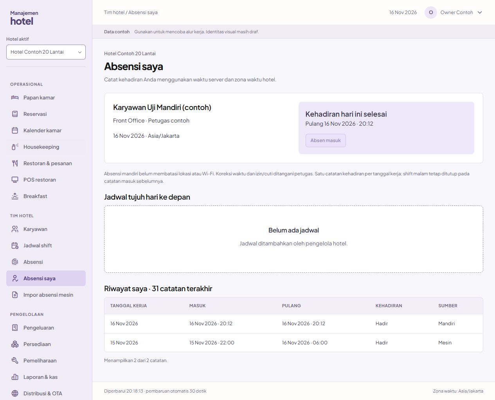
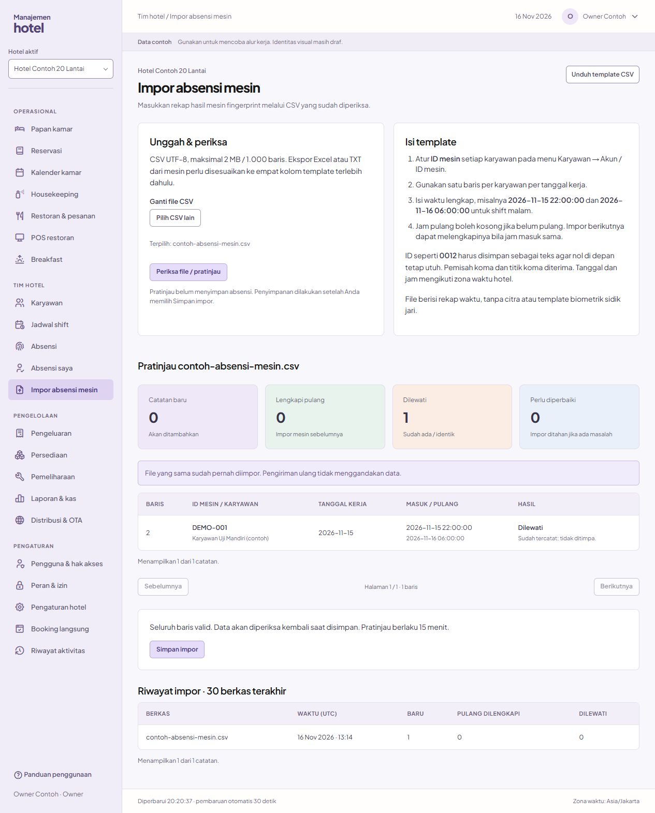

# Absensi mandiri dan impor mesin

Tersedia mulai pembaruan 16 November 2026. Merek mesin belum ditentukan, sehingga integrasi yang tersedia berupa impor rekap CSV. Aplikasi tidak mengambil data langsung dari mesin dan tidak menyimpan citra/template biometrik sidik jari.

## Absensi karyawan sendiri

1. Buat akun melalui **Pengguna & hak akses** jika karyawan belum mempunyai akun.
2. Pada **Peran & izin**, berikan izin **Absen sendiri melalui akun karyawan** (`attendance.self`). Izin ini tidak memberi akses daftar karyawan, absensi tim, atau data hotel lainnya.
3. Buka **Karyawan → Akun / ID mesin**, lalu pilih akun login karyawan tersebut. Pengaturan hubungan akun membutuhkan `employees.manage` dan `users.manage`. Satu akun hanya boleh terhubung dengan satu karyawan per hotel.
4. Karyawan masuk melalui akun pribadinya, membuka **Absensi saya**, lalu menekan **Absen masuk** dan **Absen pulang**. Server memilih karyawan dari akun yang terhubung dan mencatat waktu sesuai zona hotel. Pengguna tidak dapat mengirim nama/ID karyawan lain atau menentukan waktu sendiri.

Halaman pribadi menampilkan jadwal tujuh hari ke depan dan 31 catatan kehadiran terakhir milik akun tersebut. Satu tanggal masuk memiliki satu catatan. Shift malam ditutup pada catatan masuk sebelumnya. Karyawan nonaktif tidak dapat masuk baru, tetapi masih dapat menyelesaikan absensi terbuka miliknya selama akun tetap terhubung dan berizin.

Pembatasan lokasi, jaringan Wi-Fi, selfie, QR, dan GPS belum diterapkan. Koreksi waktu dan izin/cuti tetap melalui petugas berizin. Multi-sesi masuk/pulang atau jeda istirahat dalam satu tanggal belum didukung.

## Impor mesin fingerprint

1. Pada **Karyawan → Akun / ID mesin**, isi kode karyawan yang dipakai mesin. Mengatur ID mesin memerlukan `employees.manage`; tidak harus menghubungkan akun login.
2. Gunakan ID yang tetap untuk setiap karyawan. Jangan memakai ulang ID lama untuk orang lain: impor mencocokkan kode dengan pemetaan saat pratinjau. Kode diperlakukan sebagai teks, termasuk nol di depan; huruf dinormalisasi menjadi kapital.
3. Berikan izin **Mengimpor rekap absensi mesin** (`attendance.import`) kepada petugas. Izin ini juga memberi akses melihat data tim untuk memeriksa hasilnya, tetapi tidak otomatis memberi hak mengoreksi atau mengubah akun karyawan.
4. Unduh template pada **Impor absensi mesin**. Versi file dalam repository: [template CSV](templates/template-absensi-mesin.csv).
5. Ekspor data mesin, lalu susun menjadi rekap satu baris per karyawan/tanggal masuk. Jika mesin menghasilkan scan mentah berkali-kali, ringkas dahulu ke pasangan masuk/pulang sesuai kebijakan hotel. Excel/TXT tidak dibaca langsung; simpan sebagai CSV UTF-8 sesuai template.
6. Unggah dan pilih **Periksa file / pratinjau**. Periksa baris Baru, Lengkapi pulang, Dilewati, dan Perbaiki. Semua baris harus valid sebelum **Simpan impor** aktif. Pratinjau belum membuat absensi.
7. Setelah penyimpanan, hasil muncul pada Absensi tim/pribadi dengan sumber **Mesin** serta riwayat impor. Waktu riwayat impor diberi label UTC; waktu masuk/pulang pada CSV mengikuti zona hotel.

### Kolom template

| Kolom | Isi |
| --- | --- |
| `kode_mesin` | ID mesin yang sudah dipetakan ke karyawan aktif pada hotel tersebut, misalnya `0012`. |
| `tanggal_kerja` | `YYYY-MM-DD`, sama dengan tanggal pada `jam_masuk`. |
| `jam_masuk` | Waktu lengkap `YYYY-MM-DD HH:MM:SS`. Format tanpa detik juga diterima. |
| `jam_pulang` | Waktu lengkap setelah masuk, atau kosong jika belum pulang. Shift malam memakai tanggal berikutnya secara eksplisit. |

Contoh fiktif untuk hotel demo:

```csv
kode_mesin,tanggal_kerja,jam_masuk,jam_pulang
DEMO-001,2026-11-15,2026-11-15 22:00:00,2026-11-16 06:00:00
```

Pemisah koma atau titik koma serta UTF-8 BOM diterima. Batas 2 MB dan 1.000 baris per file. Header harus sesuai empat kolom template. Tidak ada inferensi jam masuk/pulang atau rollover tanggal dari scan mentah.

## Perlindungan data

- Pratinjau terikat ke hotel, akun pengimpor, isi file, pemetaan karyawan dan masa berlaku 15 menit. Saat simpan, izin dan keadaan data diperiksa kembali dengan lock.
- Satu baris bermasalah menahan seluruh impor. Tidak ada penyimpanan sebagian pada file gagal.
- File dengan isi byte yang sama tidak diproses dua kali. Catatan kehadiran identik pada file lain juga dilewati. Baris duplikat identik dalam satu file dilewati; dua isi berbeda untuk tanggal yang sama ditolak.
- Impor dapat melengkapi jam pulang yang kosong dari impor mesin sebelumnya jika waktu masuk sama. Impor tidak menimpa catatan manual, koreksi atau izin yang berbeda.
- Waktu masa depan, tanggal tidak valid, jam pulang sebelum masuk, interval bertabrakan dan absensi terbuka lain ditolak.
- Kode mesin, token dan riwayat dipisahkan per hotel. File mentah tidak disimpan permanen; riwayat menyimpan hash berkas, nama berkas, pengimpor dan jumlah hasil. Tidak ada data biometrik yang dibaca.

## Pembaruan dan demo

```powershell
php artisan migrate
```

Migrasi `2026_11_16_000006_employee_attendance` menambahkan kode mesin unik per hotel, hubungan akun unik per hotel, sumber catatan dan riwayat impor. Migrasi sudah diterapkan pada database lokal tanpa reset.

Contoh terpisah di **Hotel Contoh 20 Lantai**:

```powershell
php scripts/demo-building.php
php scripts/demo-attendance.php
```

Script kedua khusus lokal/testing menghubungkan akun Owner contoh dengan **Karyawan Uji Mandiri (contoh)**, kode `DEMO-001`, hanya di hotel demo tersebut. Akun Owner pada hotel utama tidak dihubungkan otomatis. [CSV contoh](templates/contoh-absensi-mesin.csv) hanya untuk hotel demo; ganti seluruh isinya untuk penggunaan nyata.

## Verifikasi

- **55 tests, 450 assertions** lulus pada SQLite dan MariaDB terpisah, mencakup semua regresi sebelumnya serta akun pribadi, privasi tim, waktu server, overnight, karyawan nonaktif, pemetaan unik/tenant, CSV valid/tidak valid, konflik, batas file/baris, perubahan pemetaan, token kedaluwarsa, retry dan riwayat tenant.
- Browser lokal: absen masuk/pulang contoh berhasil; CSV shift malam menghasilkan satu catatan Mesin; pengiriman ulang tidak menambah baris/batch. Pemetaan akun memakai searchable select.
- Seluruh 22 halaman berhasil dibuka kembali setelah pembaruan JavaScript; console akhir tanpa error/warning. Pada 390 px, halaman pribadi dan impor tidak meluber; pratinjau impor juga diperiksa pada 320 px dan 768 px. Viewport pengujian dikembalikan ke default.
- Berkas JavaScript utama dipulihkan dari riwayat patch setelah kesalahan encoding saat penyuntingan, kemudian diperiksa sintaks dan diuji kembali melalui navigasi seluruh modul.
- Belum diuji terhadap mesin fisik, format ekspor vendor tertentu, atau beban impor produksi. Konektor langsung/real-time memerlukan merek/model serta jalur integrasi mesin yang dipilih nanti.




